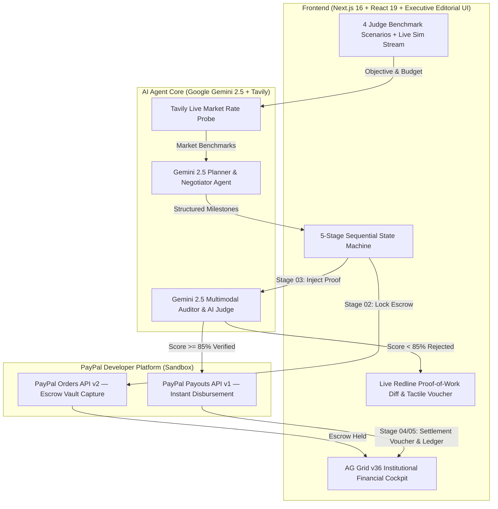

# 🛡️ Pacta — Autonomous Agent Commerce & Escrow Layer

> **Built for the PayPal AI Hackathon: Build What's Next with PayPal and AI**  
> *Enabling safe, verifiable economic autonomy for AI agents powered by PayPal Sandbox, Google Gemini 2.5, Tavily Live Intelligence, and AG Grid.*

---

## 💡 The Problem
As AI agents evolve from conversational assistants into autonomous workers capable of writing software, auditing code, localizing applications, and curating datasets, they face a fundamental roadblock: **they cannot safely participate in real-world commerce**.
- Giving an AI agent unrestricted credit card access is an extreme financial security hazard.
- Human-in-the-loop procurement for digital services and micro-contractors takes days of manual friction.
- Freelancers and provider agents have no guarantee of payment for autonomous work without trusted escrow.

## 🚀 The Solution: Pacta
**Pacta** (Latin for *"agreed terms"*) is an economic coordination and milestone escrow protocol that connects buyer agents and provider agents with cryptographic trust and financial settlement:
1. **Autonomous RFQ & Live Market Benchmarking**: A business manager defines a high-level objective and budget. The autonomous **Buyer Agent** probes live freelance market rates via **Tavily Search API** and negotiates sequential milestone allocations with provider agents.
2. **PayPal Smart Escrow Funding**: Agreed milestones generate conditional orders via the **PayPal Orders API (v2)**, securely locking escrow funds in the PayPal Sandbox vault.
3. **Live Redline Proof-of-Work Audit (Gemini 2.5 AI Judge)**: Once a provider agent submits proof-of-work (AST security manifests, localization bundles, or dataset schemas), Pacta's **Auditor Agent** conducts multimodal inspection against contractual acceptance criteria, rendering an inline **Live Redline Verification Diff** and assigning a quality score (0–100%).
4. **Programmatic PayPal Payouts**: If the deliverable satisfies criteria (score ≥ 85%), Pacta automatically triggers the **PayPal Payouts API (v1)** to disburse payment instantly to the provider's PayPal account. If defective (< 85%), PayPal escrow stays locked and blocks disbursement.
5. **AG Grid Financial Cockpit**: CFOs, treasury managers, and operators monitor all agent-driven commerce in real time via an enterprise **AG Grid v36** financial command center.

---

## 🏗️ Architecture



---

## 🏆 Prize Category Alignment

| Prize Category | How Pacta Fits |
| :--- | :--- |
| **Grand Prize / 1st Place** | Production-ready, end-to-end full-stack solution solving real economic autonomy for AI agents. |
| **Best Use of Agentic Commerce** | Autonomous agents acting as genuine economic buyers, negotiators, auditors, and service providers. |
| **Best Use of PayPal + AI** | Synergistic workflow: Gemini 2.5 + Tavily handle reasoning & redline verification; PayPal Orders v2 & Payouts v1 handle escrow and instant settlement. |
| **Best Use of AG Grid** | Institutional financial ledger built on AG Grid Community v36 with real-time status pills, AI score bars, quick filters, and CSV export. |
| **Best Use of Render** | Production web deployment on Render with unified Next.js SSR and API routes. |

---

## 🎨 Executive Editorial Paper & Ink UI Design
Pacta eschews generic dark SaaS templates in favor of a bespoke **Executive Editorial Paper & Ink** aesthetic inspired by institutional financial journals and legal redline workstations:

1. **Editorial Typography & Warm Paper Stock (`#F7F6F2`)**:
   - Authoritative `Newsreader` serif headers paired with `Geist Sans` body copy and `Geist Mono` cryptographic telemetry on warm archival paper cards (`#FFFFFF` / `#FAF9F6`) with crisp `#E5E4DE` borders.
   - High-contrast solid black capsule pills (`#18181B`) for instant visual hierarchy across scenarios and stages.

2. **5-Stage De-Clustered State Machine**:
   - Eliminates cognitive overload by transitioning cleanly through 5 sequential stages: `01 RFQ SPEC` → `02 ESCROW LOCK` → `03 REDLINE AUDIT` → `04 DISBURSEMENT` → `05 AG GRID LEDGER`.

3. **Live Redline Proof-of-Work Verification Diff (Stage 03)**:
   - Judges can test **1-Click Dual-Path Benchmark Injectors**:
     - `🟢 Inject Passing Proof (96%)`: Underlines verified artifacts in sage emerald, stamps approval, and triggers PayPal Payouts v1.
     - `🔴 Inject Failing Proof (42%)`: Strikes through defective deliverables in crimson redline, flags missing requirements, and keeps the PayPal Escrow Vault locked.

4. **Tactile Perforated Escrow Vouchers & Web Audio Synthesizer (Stage 04)**:
   - Realistic **perforated paper deposit slips** with cutout notches, 10-segment analog verification meters, and diagonal rubber ink stamps (`PAID & DISBURSED`).
   - Built-in **Web Audio API synthesizer** generates tactile mechanical clicks, rubber stamp thuds, and settlement chimes with zero external audio files.

5. **Interactive Spotlight Tour (`Guide Me`) with Auto-Stage Reset**:
   - 9-step interactive tour that automatically switches stages, scrolls to and spotlights the active component with a glowing amber ring, and **automatically resets back to Stage 01 upon completion**.

---

## 🔑 BYOK (Bring Your Own Key) & Zero-Crash Resilience
Judges and evaluators can test Pacta with their own live credentials or test immediately out-of-the-box without typing a single key:

- **PayPal Sandbox Credentials**: Supports custom `Client ID` and `Client Secret` via the `BYOK Keys` modal. Executes real Orders v2 and Payouts v1 calls against PayPal Sandbox (`https://api-m.sandbox.paypal.com`).
- **Google Gemini 2.5 API Key**: Powers autonomous milestone decomposition, price negotiation, and multimodal deliverable verification.
- **Tavily AI Search API Key**: Powers live real-time market rate benchmarking.
- **Client-Side Privacy**: Keys are stored strictly in browser `localStorage` and dispatched per request via custom headers (`x-paypal-client-id`, `x-gemini-key`, `x-tavily-key`).
- **Resilient Fallback Engine**: If any key is missing or rate-limited, Pacta automatically falls back to deterministic smart heuristics and sandbox mocks (`SANDBOX-ORDER-AUTO`, `SANDBOX-BATCH-PAYOUT`). Judges will **never experience a crash or blocking error**.

---

## ⚡ Quick Start & Run Instructions

### 1. Clone & Install Dependencies
```bash
git clone https://github.com/your-username/pacta-agentic-commerce.git
cd pacta-agentic-commerce
npm install
```

### 2. Configure Environment Variables (Optional)
Copy `.env.example` to `.env.local` if you wish to pre-populate server-side keys (or use the in-app **BYOK Keys** modal):
```bash
cp .env.example .env.local
```

### 3. Run Development Server
```bash
npm run dev
```
Open **[http://localhost:3000](http://localhost:3000)** in your browser.

---

## 🧪 60-Second Judge Evaluation Guide
1. **Switch Scenarios (`✨ SCENARIOS`)**: Click between *DeFi Security Audit ($280)*, *Global Localization ($190)*, *API Red-Team ($340)*, or *Dataset Curation ($220)* in the top pill bar.
2. **Toggle `LIVE SIM: ACTIVE`**: Watch real-time synthetic agent micro-transactions stream into the protocol every 4.5 seconds.
3. **Test Stage 03 Dual-Path Redline Audit**: Jump to `03 REDLINE AUDIT` and click both **`🟢 Inject Passing Proof (96%)`** and **`🔴 Inject Failing Proof (42%)`** to see how Gemini 2.5 protects PayPal escrow funds.
4. **Click `Guide Me` or `60s Auto-Demo`**: Experience the guided spotlight tour (which cleanly resets to Stage 01 when finished).

---

## 📄 License
This project is licensed under the **MIT License** — see the [LICENSE](LICENSE) file for details.
